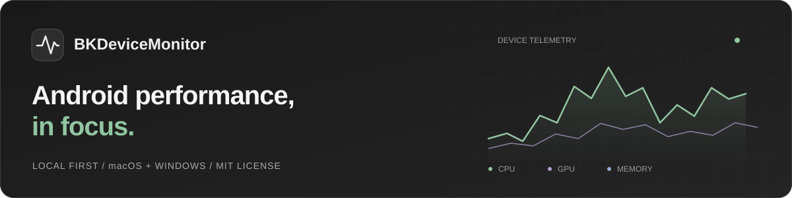
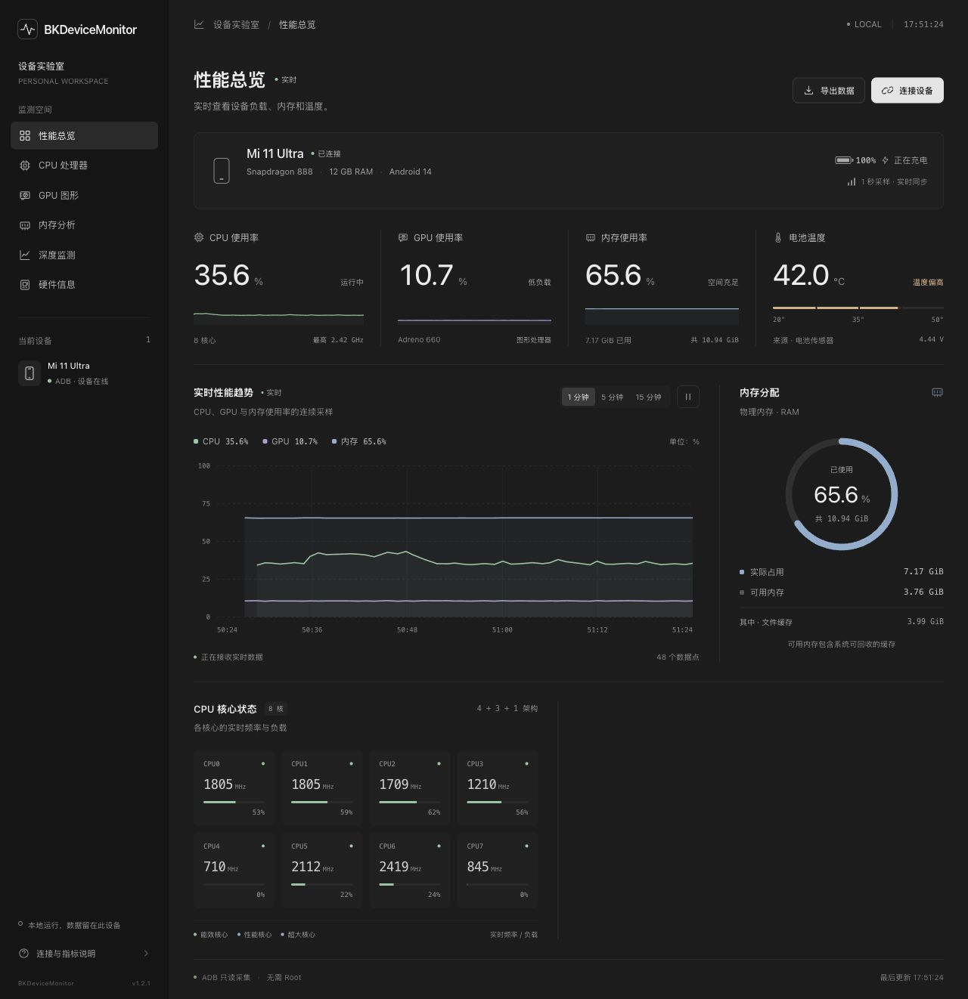
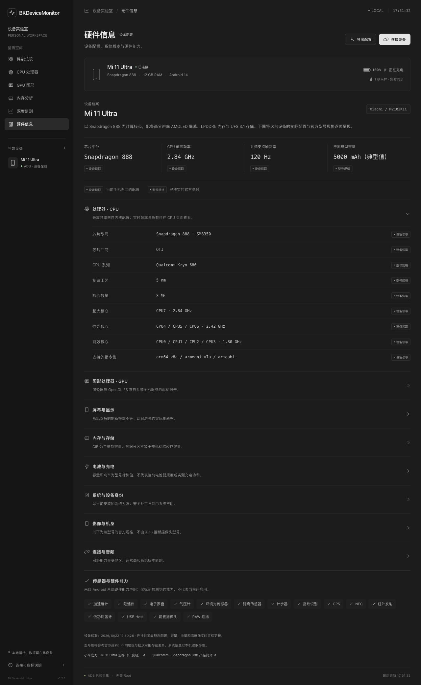

<div align="center">



# BKDeviceMonitor

**A clearer view of your Android device.**

A local Android performance monitor for your desktop. Connect a phone, inspect load and frame timing, explore its hardware, and export your findings.

[简体中文](README.md) · [**English**](README.en.md)

[](LICENSE)  

[Preview](#-preview) · [Features](#-what-you-can-do) · [Quick start](#-quick-start) · [Development](#-development--builds) · [Metrics guide](docs/metrics.en.md)

</div>

## ✨ What you can do

- **Watch workloads change** — Track total and per-core CPU load, live frequencies, GPU, memory, and battery status with continuous charts and hover readings.
- **Inspect app performance** — Follow the foreground app or select a running one to inspect app CPU and memory, plus FPS, frame intervals, and jank where available.
- **Explore device hardware** — Browse CPU, GPU, display, storage, system, and sensor details, with device readings clearly distinguished from official model specifications.
- **Keep a test record** — Capture sessions, peaks, and summaries; export CSV trends, JSON session reports, and hardware profiles.
- **Stay focused** — A Codex-inspired dark workspace, restrained chart colors, and an immersive macOS window. Desktop mode needs no separate backend.

> 🔌 Connect over USB / ADB. No root, Shizuku, or companion phone app required. Once dependencies and ADB are prepared, monitoring and analysis work offline.

## 🖥 Preview

### Performance overview



<details>
<summary><strong>Show the device hardware profile</strong></summary>



</details>

<sub>Captured from a real Mi 11 Ultra in web mode, which shares its interface and collection engine with the desktop app. The serial number and active process list are hidden for public presentation. The app interface currently uses Simplified Chinese; bilingual support here refers to the project documentation.</sub>

## 📊 Data & capabilities

| Module | What it shows |
| :--- | :--- |
| CPU | Total / per-core utilization, live frequencies, online cores, and core groups |
| GPU | Readable Qualcomm KGSL utilization, driver details, and graphics capabilities |
| Memory | Used / available / cached RAM, swap, readable PSI pressure, and major faults |
| Apps & frames | Target main-process CPU, PSS / RSS, threads; Perfetto FPS, P95 / P99 frame intervals, jank, and dropped frames |
| Thermals & battery | Readable CPU / GPU / skin / battery temperatures, system thermal status, charge level, voltage, charging state, and estimated net battery power |
| Network | Device-wide upload / download rates |
| Hardware profile | SoC, GPU, display modes, RAM / storage, system build, security patch, sensors, and official specifications for matching models |
| Trends & reports | 1 / 5 / 15-minute trends, display pause, CSV exports, session JSON, and hardware JSON |

**Every metric has a source and a limit.** Unsupported or unreadable values display `—`. Missing data is never filled with simulated values, and display refresh rate is never used as FPS. GPU, Perfetto, temperature, and PSI availability depend on Android version, vendor interfaces, and permissions.

CPU is normalized to a device-wide `0–100%` scale. Memory utilization is `1 − MemAvailable / MemTotal`. App CPU and memory cover the main process only. Battery temperature is not CPU temperature; estimated net battery power is not charger input power. See the [metrics guide](docs/metrics.en.md) for sampling details.

## 🚀 Quick start

### Run from source

You need **Node.js 22.12+**, npm, and an Android phone with USB debugging enabled. Installing dependencies and preparing ADB initially require internet access.

```sh
git clone https://github.com/binbinku/BKDeviceMonitor.git
cd BKDeviceMonitor
npm ci
npm run prepare:adb
npm start
```

1. Enable **USB debugging** in the phone's Developer options.
2. Connect with a data-capable USB cable and choose **Allow USB debugging** on the phone.
3. Open the app and wait for automatic connection, or choose your phone through the connection dialog.

On Windows, install the phone manufacturer's USB driver if the device is not recognized by ADB. The preparation script downloads macOS / Windows ADB from [Google's official Platform Tools](https://developer.android.com/tools/releases/platform-tools). Set `ADB_PATH` to use an existing ADB executable instead.

### Platform status

| Platform | Build target | Validation |
| :--- | :--- | :--- |
| macOS · Apple Silicon | ARM64 ZIP | Tested with a Mi 11 Ultra |
| macOS · Intel | x64 ZIP | Cross-built; not yet tested on matching hardware |
| Windows 11 | x64 ZIP | Cross-built; not yet tested on matching hardware |

Run from source as above, or build your own package. No prebuilt GitHub Release has been published yet. Packages include Electron and ADB, so end users need neither Node.js nor Android Studio. Current macOS builds are ad-hoc signed and not notarized; Windows builds have no certificate signature.

## 🛠 Development & builds

| Command | Purpose |
| :--- | :--- |
| `npm start` / `npm run dev` | Launch the Electron desktop app |
| `npm run prepare:adb` | Download official ADB and preserve upstream notices, source metadata, and archive SHA-256 records |
| `npm test` | Run parser, engine, session, and local access restriction tests |
| `npm run pack:mac` | Generate an app directory for Apple Silicon Macs |
| `npm run build:mac` | Build macOS ARM64 and x64 ZIP packages |
| `npm run build:win` | Build a Windows x64 ZIP package |
| `npm run web` | Start the optional web entry at `http://localhost:3210` |

Build outputs are written to `release/`. On Windows, extract the entire archive and keep `resources` and DLLs alongside the executable.

```text
BKDeviceMonitor/
├── desktop/           Native window, restricted IPC, save dialogs, ADB resolution
├── public/            HTML / CSS / JavaScript UI and Canvas charts
├── monitor.mjs        Local collection engine
├── metrics.mjs        Core CPU / GPU / memory metrics
├── hardware.mjs       Hardware parsing and model profiles
├── telemetry.mjs      Apps, thermals, network, and memory pressure
├── trace.mjs          Perfetto frame and current parsing
├── session.mjs        Test session statistics and reports
├── server.mjs         Optional web adapter
└── tests/             Automated tests
```

### Local operation & retention

The desktop app uses restricted IPC and a local resource protocol, with **no HTTP server**. ADB still uses its standard local daemon, normally on port `5037`. The renderer enables sandboxing and context isolation, with Node integration disabled. The optional web entry listens only on `127.0.0.1` and checks request origins.

Recent trends stay in memory for approximately 15 minutes. Pausing freezes the display while collection and sessions continue. Sessions survive page changes and UI reloads but are cleared when the app exits. Export before closing to keep your results. Reports include at most the latest 20,000 session samples; see [session details](docs/metrics.en.md#test-sessions).

## 🤝 Contributing

[Issues and suggestions](https://github.com/binbinku/BKDeviceMonitor/issues) and [pull requests](https://github.com/binbinku/BKDeviceMonitor/pulls) are welcome. For compatibility reports, include your phone model, Android version, desktop OS, and reproduction steps. Remove serial numbers and other personal information from logs. Include relevant test results for collection or parser changes.

Built with [Electron](https://www.electronjs.org/), [Android Platform Tools](https://developer.android.com/tools/releases/platform-tools), and [Perfetto](https://perfetto.dev/). Thanks to the projects and people behind these tools.

## 📄 License

The project's original code is available under the **[MIT License](LICENSE)**. Use, modify, and distribute it, including commercially, while retaining the copyright notice and license text.

Electron, ADB, and other third-party dependencies retain their own licenses and notices. This project's MIT license does not replace upstream licenses. Bundled ADB retains its upstream `NOTICE.txt`.

---

<div align="center">
<sub>BKDeviceMonitor · Made for every cycle.</sub><br />
<sub><a href="README.md">阅读简体中文版 →</a></sub>
</div>
